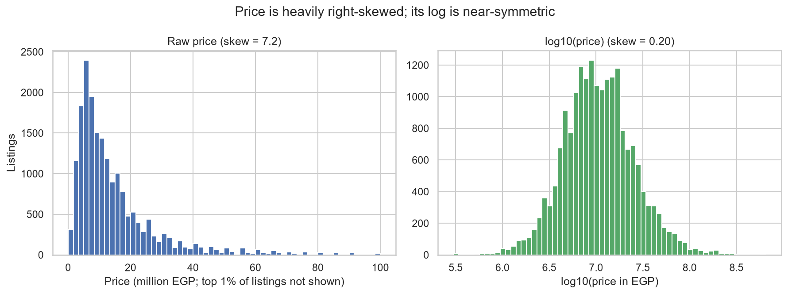
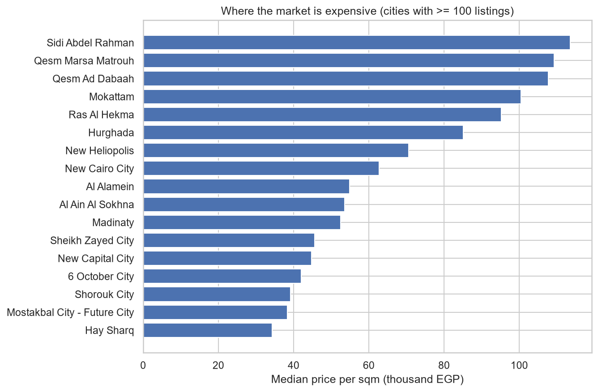
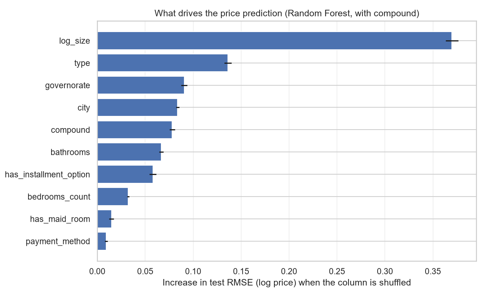

# Egypt Real Estate Price Predictor

End-to-end classical machine learning on real Egyptian property listings: messy-data cleaning, exploratory analysis, a leakage-safe scikit-learn pipeline, honest model comparison, and feature importance.

**Best result:** Random Forest predicts listing prices with a **median error of 19.7%**, and **50.4% of test listings fall within ±20%** of the true price (R² = 0.755 on log price). A naive baseline that always guesses the median price has a 52.3% median error.

---

## The problem

Asking prices for Egyptian property vary enormously: from 300K EGP to 650M EGP in this dataset. The question: how well can we estimate a listing's price from basic, structured facts (size, rooms, type and location), and which of those facts matter most?

## Data

- **Source:** [Egyptian Real Estate Listings](https://www.kaggle.com/datasets/hassankhaled21/egyptian-real-estate-listings) on Kaggle (scraped from PropertyFinder Egypt), licensed **CC BY 4.0**.
- **Size:** 19,924 raw listings, 11 columns.
- The data file is **not** included in this repo. Download it and place it at `data/raw/egypt_real_estate_listings.csv`, or run `python -m src.data.download` (needs `KAGGLE_USERNAME` and `KAGGLE_KEY` in a `.env` file).

## Cleaning

The raw data is genuinely messy: prices stored as text with commas, sizes like `"732 sqft / 68 sqm"`, bedrooms like `"3+ Maid"` or `"studio"`, 1,535 unique location strings, and `down_payment` about 73% empty.

| Step | Rows |
|---|---|
| Raw | 19,924 |
| Exact duplicates removed (before any split) | −171 |
| Missing price or size removed | −461 |
| Implausible price per sqm removed (outside 2,000–500,000 EGP) | −41 |
| **Final** | **19,251** |

Key decisions:
- **Duplicates removed before splitting**, so copies can't appear in both train and test and inflate scores.
- **Bedrooms** split into a count plus a separate maid's-room flag.
- **Location** split into governorate, city and compound (most specific part of the location string).
- **Missing down payment** becomes a `has_installment_option` flag, since a missing value almost certainly means cash only.
- **`available_from` dropped**: all values fall in a two-month window, so it is a listing date, not a delivery date.
- **Plausibility bounds are fixed constants**, not percentiles computed on the full data, so no information from test rows leaks into cleaning.

## Exploratory analysis



- Price is heavily right-skewed (skew 7.2). Its log is near-symmetric (skew 0.2), so **models predict log(price)** and errors are reported back in EGP.
- Correlation with log price: size 0.63, bathrooms 0.61, bedrooms 0.54, maid's room 0.32, installment flag 0.03.
- Median price per sqm: North Coast ~97K, Red Sea ~85K, Cairo ~57K, Giza ~42K EGP. Resort towns are the most expensive; satellite cities the cheapest.



`price_per_sqm` is used for analysis only. It is computed from price, so using it as a feature would be **target leakage**.

## Modeling approach

- **Target:** log(price).
- **Features:** log size, bedrooms, bathrooms, maid's room, installment flag, payment method, property type, governorate, city, and (in the second feature set) compound.
- **Pipeline:** a scikit-learn `ColumnTransformer` inside each model's `Pipeline`. Numeric columns get median imputation and scaling; categorical columns get one-hot encoding where rare categories are grouped using **training data only** (`min_frequency=100`, or 20 for compounds; unseen categories at test time go to the same group).
- **Split:** 80/20 random split with a fixed seed. 5-fold cross-validation on the training set; the test set is used once per model.
- **Models:** median baseline, Ridge, Random Forest, and scikit-learn's `HistGradientBoostingRegressor`.

## Results

Test set, 3,851 listings. Median % error and "within ±20%" are measured on real EGP prices.

| Features | Model | CV RMSE (log) | Test R² (log) | MAE (M EGP) | Median % error | Within ±20% |
|---|---|---|---|---|---|---|
| — | Median baseline | 0.869 ± 0.009 | 0.000 | 10.21 | 52.3% | 18.3% |
| City level | Ridge | 0.535 ± 0.012 | 0.626 | 6.30 | 30.3% | 33.4% |
| City level | Random Forest | 0.481 ± 0.008 | 0.711 | 5.28 | 23.3% | 44.9% |
| City level | Gradient Boosting | 0.487 ± 0.009 | 0.692 | 5.67 | 26.1% | 38.5% |
| + Compound | Ridge | 0.480 ± 0.011 | 0.704 | 5.29 | 23.3% | 43.0% |
| **+ Compound** | **Random Forest** | **0.441 ± 0.007** | **0.755** | **4.70** | **19.7%** | **50.4%** |
| + Compound | Gradient Boosting | 0.440 ± 0.006 | 0.751 | 4.88 | 21.6% | 47.1% |

Full numbers: [`reports/model_comparison.csv`](reports/model_comparison.csv).

What this shows:
- **Every model clearly beats the baseline**, so the features carry real signal.
- **Adding the compound name is the biggest single improvement.** CV error drops by 0.04, about 6× the fold-to-fold variation. Ridge gains the most (30.3% → 23.3% median error): location detail matters a lot for price.
- **Random Forest and Gradient Boosting are effectively tied** with compound (0.441 vs 0.440 CV RMSE, within one standard deviation). Gradient Boosting is untuned, so neither is clearly better.
- **CV and test scores agree**, so the results are stable rather than a lucky split.

## What drives price

Permutation importance on the test set (Random Forest with compound): each input column is shuffled and the increase in test error is measured.



- **Size dominates**, about 3× any other feature.
- **Property type** is second (villa vs. apartment, etc.).
- **Location** (governorate, city, compound) looks moderate per column, but the three overlap: shuffle one and the others still roughly locate the listing. Together, location is the second-biggest driver after size.
- **Bedrooms ranks low** for the same overlap reason: size and bathrooms already carry most of that information.
- **The installment flag ranks 7th** despite a near-zero simple correlation with price (0.03), so the model uses it in combination with other features. A likely explanation is that installment listings are often new developer sales while cash listings are often resales, but this is a hypothesis, not something the data proves.

## Limitations

- **~20% typical error is useful for a price range, not for pricing a specific unit.** The data has no finishing level, floor, view, delivery date or unit condition, all of which matter in this market.
- **Compound accuracy assumes a known compound.** The random split puts listings from the same compound in both train and test. For a brand-new compound, accuracy will fall back toward the city-level numbers. A group split by compound would measure that case.
- **These are asking prices, not sale prices.** Listings can be over- or under-priced, and the same unit may be listed by several brokers.
- **One snapshot in time.** All listings come from a roughly two-month window. With Egypt's recent inflation and currency changes, the model would need regular retraining.
- **Some location oddities remain.** For example, Mokattam shows a higher median price per sqm than Hurghada, likely driven by a few premium compounds listed under it. A handful of 10,000+ sqm listings (probably land plots) survive cleaning because their price per sqm looks normal.
- **Models are not tuned.** Hyperparameters are reasonable defaults; tuning could improve results slightly.

## Project structure

```
egypt-real-estate-price-predictor/
├── main.py                     # runs the full pipeline
├── requirements.txt
├── pytest.ini
├── src/
│   ├── data/download.py        # optional Kaggle downloader
│   ├── cleaning/clean.py       # raw -> clean listings
│   ├── analysis/eda.py         # exploratory analysis + figures
│   ├── features/engineer.py    # features, preprocessor, split
│   ├── modeling/train.py       # model comparison
│   └── evaluation/
│       ├── metrics.py          # log-scale and EGP metrics
│       └── importance.py       # permutation feature importance
├── tests/                      # 34 tests on synthetic data
├── reports/
│   ├── model_comparison.csv
│   ├── feature_importance.csv
│   └── figures/
└── data/                       # not committed (see Data section)
```

## How to run

```bash
python -m venv erep-env
erep-env\Scripts\activate          # Windows
# source erep-env/bin/activate     # macOS / Linux
pip install -r requirements.txt

# place the Kaggle CSV at data/raw/egypt_real_estate_listings.csv, then:
python main.py                     # full pipeline, ~2.5 minutes
python main.py --skip-eda          # skip the plots

pytest -v                          # 34 tests, a few seconds
```

Individual steps can be run with `python -m src.cleaning.clean`, `python -m src.analysis.eda`, `python -m src.modeling.train` and `python -m src.evaluation.importance`.

## Tech stack

Python, Pandas, NumPy, scikit-learn, Matplotlib, Seaborn, pytest.

## License

Code: [MIT](LICENSE). Data: CC BY 4.0, from the Kaggle dataset linked above.
